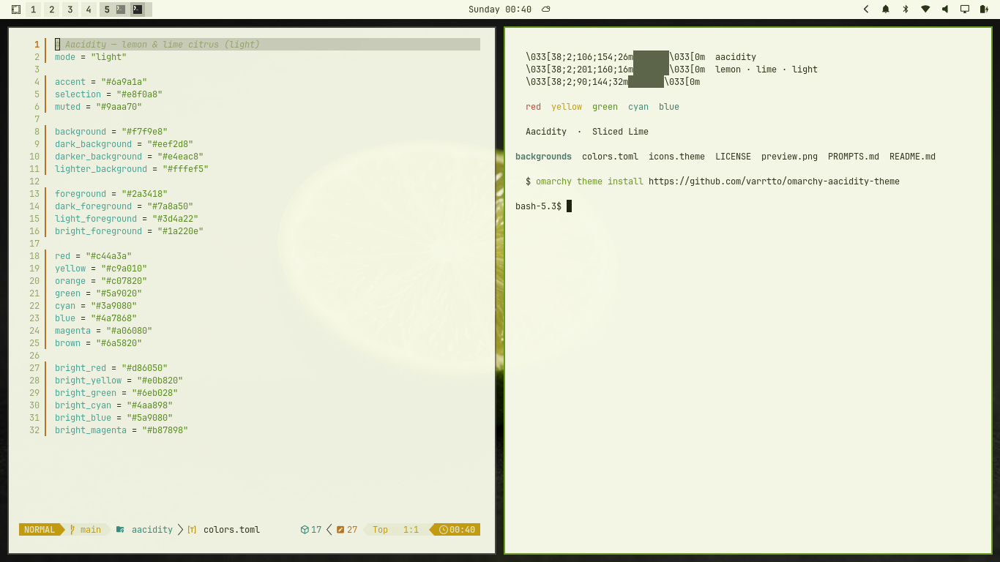
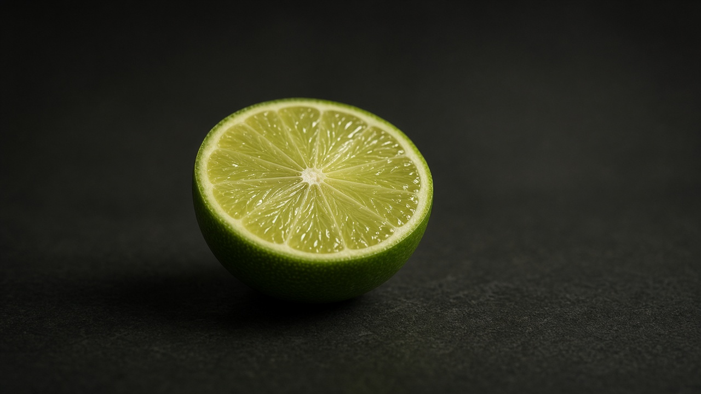
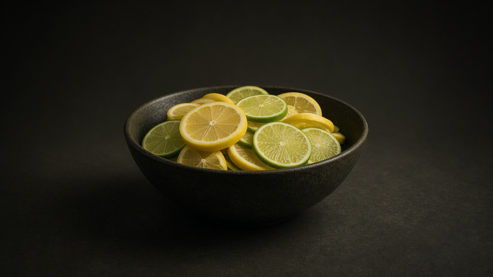

# Aacidity for Omarchy

A lemon-and-lime citrus theme: deep olive-black surfaces, sharp lemon-lime accents, pale lemonade text, and olive folder icons.



## Install

```sh
omarchy theme install https://github.com/varrtto/omarchy-aacidity-theme
```

## Backgrounds

Two original wallpapers are included. Cycle through them with `omarchy theme bg next`.

### Sliced Lime



### Citrus Bowl



Wallpapers were generated with AI image generation. The [generation prompts](PROMPTS.md) are included.

## Palette

| Role | Color |
| --- | --- |
| Background | `#141810` |
| Foreground | `#e8f0c8` |
| Lemon-lime accent | `#c6e05a` |
| Selection | `#3a4a22` |

Omarchy generates application themes from `colors.toml`.

## License

MIT
